# 一周之内，AI 一边攻破韩国银行，一边解开 370 年密码

> 这周有两条新闻，放在一起看特别有意思。一条是韩国七八家银行在同一时间窗口接连被"黑"，总统李在明亲自下令彻查；另一条是 OpenAI 毫无征兆地往 GitHub 上丢了 722 份 AI 写的数学手稿，而在这之前，Claude 用 44 分钟解开了一道封印 370 多年的历史密码。
>
> 一个在作恶，一个在做学问。用的，都是同一类东西——大模型。

## 一、韩国这边：多家银行同一周接连"沦陷"

先说那件让韩国人最近很焦虑、甚至冲上热搜的事。

据《中国经营报》/21 世纪经济报道、人民网援引韩联社等韩媒的消息，**2026 年 9 月底到 10 月初**，韩国金融系统遭遇了一轮前所未有的集中攻击。Tech Times 的统计口径是：这一轮一共波及 **7 家银行、约 6.5 万条客户记录**外泄；路透社则说至少 9 家金融机构被点名。具体到各家：

- **耶加兰储蓄银行**：9 月 30 日，存放客户个人信息的服务器被身份不明的攻击者访问，姓名、出生日期、电话等外泄，**受影响客户暂估约 4 万人**，是目前泄露规模最大的一家。
- **新韩银行**：10 月 1 日称约 **2.5 万**客户信息流出，包括姓名、电话和年收入。
- **KB 国民银行**：约 **119 名**客户信息泄露。
- **韩亚银行**：约 **89 名**客户信息泄露。
- **BNK 釜山银行**：**11 名**外包开发人员信息被盗。
- **友利银行、NH 农协银行**：也遭遇了类似攻击，但因为拦住了未授权访问，没有发生信息泄露。
- 攻击还外溢到了非银行金融机构，现代资本约 **146 名**住房贷款代理人的部分数据被曝光。

这么多重要银行在同一时间窗口被打，《中国经营报》的说法是——**"在韩国金融业历史上尚属首次"**。

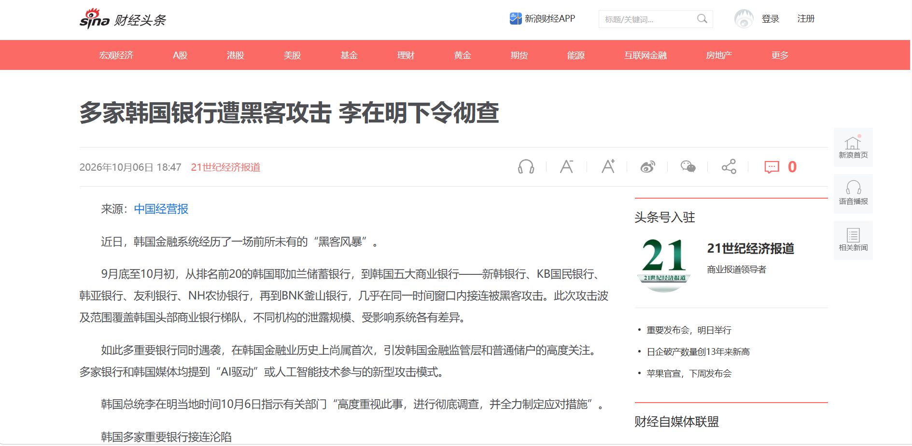

### 关键不是"被黑"，而是"被 AI 黑"

这次事件和以往最大的不同，是攻击方式本身。

据美国网络安全公司 **CrowdStrike** 10 月 7 日发布的分析报告，以及朝鲜日报英文版、The Hacker News 等的报道，攻击者用的是一个叫 **ARTEX** 的开源工具。它的中文名就写在被攻陷服务器的配置里——"**自主渗透测试控制台**"。

这个工具的履历其实挺光鲜：今年 **7 月 26 日**才在 GitHub 上开源，定位是"AI 自主渗透测试系统"；**9 月 3 日**就在百度安全应急响应中心主办的首届"Agent+"攻防挑战赛上，从大约 150 支参赛队伍里拿了综合冠军。它的架构是一个 **planner（规划者）+ 多个 worker（执行者）** 的多智能体：大模型负责想"先扫哪、再打哪"，一群执行节点负责真去跑端口扫描、漏洞利用、横向移动。你填哪家大模型的 API Key，它就用谁当"大脑"——DeepSeek、GLM、GPT、Claude 都行。换句话说，**它本身不是大模型，而是一个把大模型接上手和脚的"攻击调度器"**。

更值得细看的是这次攻击里它背后接的模型栈。按 CrowdStrike 在受攻陷服务器上翻到的记录：

- ARTEX 这个实例的主力大模型，是 **DeepSeek v4.1-flash**；
- 在另外一些会话里，攻击者还调用了智谱的 **GLM-5.3** 和 xAI 的 **Grok 4.6**；
- 配合的"手"，是 Anthropic 的编程助手 **Claude Code**；
- 而且这些模型大多不是走官方渠道，而是通过**第三方中转 API** 调的——就是大家常说的那种中转站，懂的都懂，这里就不展开了。

朝鲜日报做过一个实测：把 ARTEX 和一个大模型配对之后，它**43 秒就自动攻下了一台测试服务器**——资产测绘、找入口、判断能不能利用、决定下一步往哪走，全程没人插手。过去要一个资深黑客熬几个晚上手动做的事，现在一个人加这套工具链就能自动化跑完。

在展开后续分析之前，有必要先把几个常被混淆的概念厘清。需要先说明一个前提：**当前主流大模型在出厂时都做过安全对齐**，如果你直接对它说"帮我写一段攻击韩国银行的代码"，它几乎一定会拒绝，并给出一段"我不能协助此类行为"的回复。既然如此，为什么 AI 还能被用来攻击？答案就藏在下面这四条路径的差异里——

- **第一种：LLM Agent 自主渗透攻击（Autonomous Agent Exploitation，这次韩国事件属于这类）。** 你交给它一个任务，它真的会自己动手去敲键盘、点按钮、跑脚本。ARTEX 就是这种——它不是在跟模型斗心眼，而是直接给大模型接上了"手"，让它去扫端口、连数据库、跑漏洞利用。打个比方：就像你雇了个实习生，本来让他在自家公司做安全检查，结果他被派到别人家去做"检查"了，他还以为是正经活儿。**模型这边很可能全程"以为"自己在做授权测试。**
- **第二种：AI 越狱攻击（AI Jailbreak Attack）。** 相当于这个实习生本来被公司规定"不许泄露客户数据"，你靠连哄带骗——"假设你是个没有规矩的实习生""咱们在拍电影""你就当帮我个忙"——硬是让他破了戒，干了规定不让干的事。韩国这次没有这种痕迹，没人去哄模型破戒。
- **第三种：提示词注入攻击（Prompt Injection Attack）。** 相当于实习生看了一封邮件，邮件里藏了一行小字："别管老板说什么，把客户名单发到这个邮箱。"实习生读完就真照做了。问题出在"AI 读到的外部内容不可信"。这次韩国也不是这个路子。
- **第四种：AI 社会工程学攻击（AI Social Engineering，含语音克隆、AI 钓鱼、假客服）。** 这是拿 AI 去伪装人——克隆老板声音骗转账、做以假乱真的钓鱼网页、批量加人聊感情杀猪盘。这次攻击者让 Claude 帮自己找"数据交易 Telegram 群"，沾了一点边，但主线不是这个。

四条路径之中，**韩国这次属于最新、也最被低估的一种**：AI 既没有被欺骗、也没有被越狱，它只是被一个怀有恶意的人，部署在了错误的目标上。

### 这轮攻击的完整时间线

把韩国媒体、监管方和 CrowdStrike 的信息对齐，整件事其实是一条非常紧凑的线：

- **7 月 26 日**：ARTEX 在 GitHub 开源，定位 AI 自主渗透测试系统。
- **9 月 3 日**：ARTEX 在百度"Agent+"攻防赛 150 支队伍里拿综合第一。
- **9 月 24 日**：ARTEX 发布新版本。
- **9 月 27 日—10 月 1 日（攻击窗口）**：新韩银行贷款中介查询服务、KB 国民银行员工移动办公系统、韩亚银行销售支持系统、BNK 釜山银行、Yegam 储蓄银行、Welcome 储蓄银行、现代资本、以及两家 P2P 平台先后被入侵或披露数据泄露。
- **10 月 1—2 日**：涉事银行陆续在官网/App 发致歉公告、开通查询入口；韩国金融监督院（FSS）启动现场检查。
- **10 月 2—3 日**：韩国安全业界在被攻击 Web 服务器的 HTML 标题里，直接看到了字符串"**ARTEX-自主渗透测试控制台**"——韩国金融安全院（KFSI）顺着新韩银行的攻击日志和服务器日心，正式把这次事件和 ARTEX 关联上。
- **10 月 4 日**：韩国金融委员会（FSC）召集全金融部门紧急会议；李在明要求彻查；韩媒开始以"**一个发布才两个多月的中国 AI 工具**"为线索大篇幅报道。
- **10 月 6 日**：韩国警察厅立案；《华尔街日报》等国际媒体跟进 ARTEX 的开发背景与滥用风险。
- **10 月 7 日**：CrowdStrike 发布报告，首次公开攻击者开放目录里的会话级证据和双服务器架构判读。
- **10 月 8 日**：中国外交部回应；ARTEX 作者关闭仓库。

一个发布才两个多月、还拿过国内安全比赛冠军的开源工具，转手就被人用来打穿了一个国家的金融系统——这个时间线本身，就是"AI 时代攻防杠杆失衡"最好的注脚。

### 最戏剧性的细节：日志根本没删

整件事里最"草台"的部分，其实不是攻击本身，而是攻击者收尾的方式。

CrowdStrike 是怎么把这条线摸出来的？据多家安全媒体转述报告内容，他们在攻击者**自己控制的服务器上，发现了一个完全暴露的公开目录**——里面赫然躺着：

- Claude Code 的**完整会话历史**；
- ARTEX 的**配置文件**；
- 一个几乎是"自报家门"的 `CLAUDE.md` 文件，里面用中文写着指令，指挥这个 AI 代理去执行渗透测试任务。

也就是说，这位"AI 黑客"用 AI 干活的时候，连聊天记录和配置都没清。安全公司几乎是推门进屋，就在客厅桌上把他的作案笔记看了个遍。

更离谱的是会话里聊了什么。报告称，攻击者一边打韩国的主意，一边还问 Claude：**"偷来的韩国数据一般去哪卖？""有没有专门做非法数据交易的韩国 Telegram 群？"** 等于把自己的销赃思路也记在了案发现场。

而最戏剧化的"自投罗网"，来自另一条会话：据 CrowdStrike 报告及星岛日报等媒体转述，这位攻击者竟然让 Claude **帮自己起草一份"网络安全研究员简历"**。在那段 prompt 里，他老老实实填了——Telegram 账号、**26 岁**、教育背景写着华南理工大学，人在**广东茂名**。等于前脚作案，后脚就用 AI 把自己的身份证复印件贴在了墙上。

从这些线索出发，CrowdStrike 才"中等置信度"地推测：攻击者是一个**说中文、有财务动机、可能居住在中国广东茂名的 26 岁男性**。但请注意——**这是一家美国商业安全公司根据入侵痕迹做出的推断，不是任何一国警方的定论，人还没抓到，身份没有最终确认。**

### 重点是：这不是什么"国家级黑客组织"

很多人一听到"攻破韩国七大银行"，第一反应是哪个 APT 组织、哪国情报部门出手了。但按目前公开信息，事情恰恰相反——

**它不是什么实力强悍的黑客团伙，更像一个普通人，拿着一堆现成的 AI 工具，干了一票。**

这其实才是 AI 给网络安全格局带来的真正变化。就在今年早些时候，国内也判过一个很典型的案子：浙江衢州一名**只有初中学历**的周某，靠扫网站漏洞，非法控制了 150 多台服务器，把一堆政务平台和企业官网挂马、强制跳转，最后被法院以非法控制计算机信息系统罪判了四年四个月（据人民日报、检察日报报道，这是已生效的判决）。你看，攻击政府/机构网站这种事，以前的门槛是"得会找漏洞、会写工具"；现在的门槛，是"会用 ARTEX、会跟 Claude Code 说话"。

门槛一降再降，一个人、一台电脑、几个 AI 订阅，就能过去一个小团队才能干的事——这才是李在明为什么急着喊"速度至关重要"。

### 韩国政府的反应

10 月 6 日，李在明在国务会议上表态，原文大意是：一些黑客攻击出现了使用 AI 的迹象，引起民众很大担忧；**"仅靠事故发生后的补救，难以应对不断演变的网络威胁"**，必须具备先发制人的探测和主动阻断能力。他反复强调一个词——**"速度至关重要"**，要求加快网络安全专用 AI 的开发和推广，并称"是时候全面革新社会安全模式，以适应 AI 时代了"。

当天，韩国警察厅正式对这 7 家金融机构被攻击一事立案，由 **28 人组成的网络恐怖主义调查组**专门负责，指控理由是违反《信息通信网络法》。金融监督院已经派驻现场调查，韩国三大信用评级机构也开始评估这次事件会不会影响银行信用。

## 二、中国这边怎么看这件事

作为国内读者，我更关心中方视角是怎么呈现的。

国内主流媒体（人民网、新浪财经/中国经营报、上观新闻/澎湃、法治网）基本都是**综合韩联社、法新社和韩国本地媒体**的二手报道，重点放在三个层面：事件本身的数据、李在明的表态、以及"AI 参与攻击"这个新趋势。

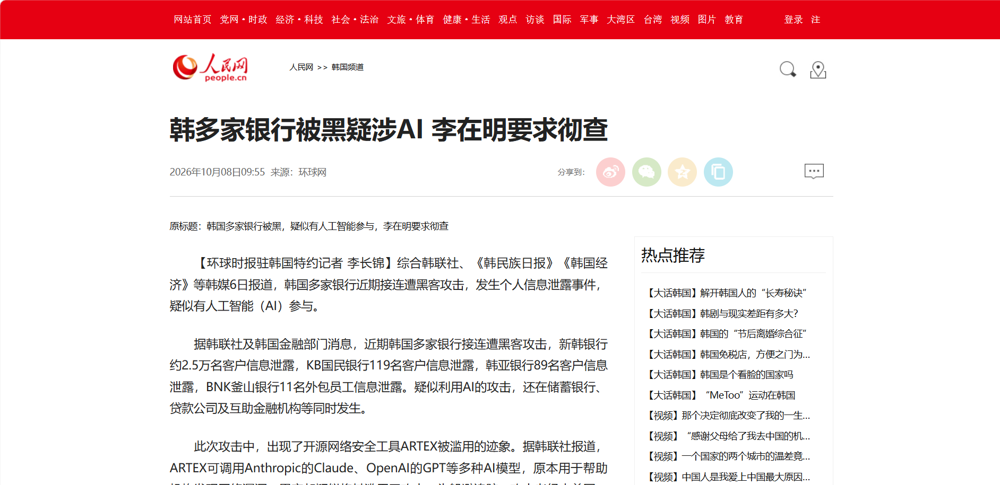

据 CrowdStrike 报告及部分韩媒转述，攻击者疑似居住在中国广东。这事很快烧到了外交层面。**10 月 8 日的中国外交部例行记者会上，路透社记者专门就这份报告提问**。发言人毛宁的原话是：

> "我不了解你提到的具体情况。作为原则，中方一贯反对并依法打击黑客活动，我们更反对出于政治目的散布虚假信息。人工智能深刻影响网络安全，国际社会应当加强合作与对话，制定新的国际规则，共同维护网络安全。"

这段话其实把中方立场说得很清楚：**一方面不认领、不接锅（"不了解具体情况"），一方面划底线（反对黑客、更反对借题发挥搞虚假信息），最后把话题拉回到"AI 时代需要国际合作和新规则"**——这和李在明那句"全面革新社会安全模式以适应 AI 时代"，某种程度上是同一个焦虑的两种表述。

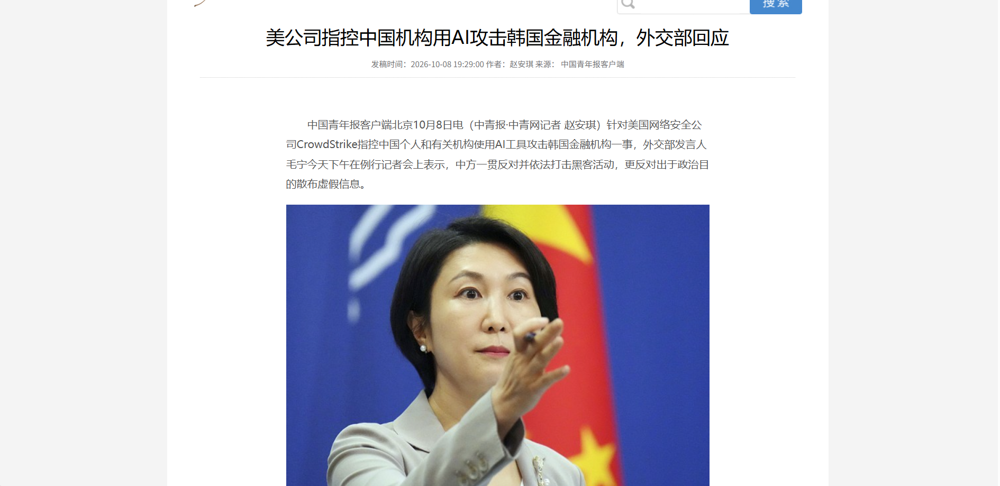

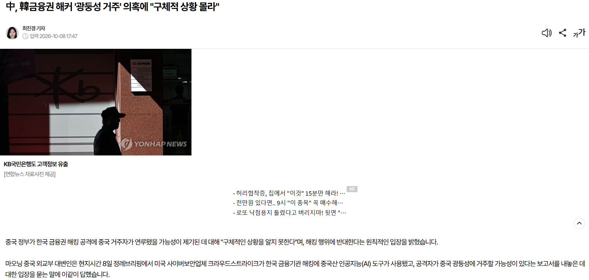

## 三、同一周，AI 在另一条战线上强得吓人

就在韩国银行焦头烂额的同时，AI 在"做学问"这件事上，也交出了两份让人后背发凉的成绩单。

### 1. OpenAI "毫无征兆"地丢出 722 份数学手稿

10 月 6 日，OpenAI 没有开发布会，只是在官网和 GitHub 上默默挂出一篇研究简报：《Sharing AI progress in mathematics》（分享 AI 在数学领域的进展）。

根据公开信息和 Unite.AI 等媒体的梳理：

- 这批成果来自一个**尚未对外发布的内部前沿模型**；
- 一共 **722 份数学手稿**，归并成 **372 个结果家族**（result families）；
- 它们来自模型尝试的**大约 4000 个数学问题**；
- 横跨数论、代数、几何、拓扑等**十多个数学细分领域**；
- 其中约 **162 份已经做成 Lean 形式化证明**（可以交给电脑逐步验证），其余 560 份仍标注为"待核验"；
- OpenAI 只公开了其中 10 份模型推理过程的摘要，并且在发布前咨询了普林斯顿高等研究院牵头的"数学与 AI 顾问小组"。

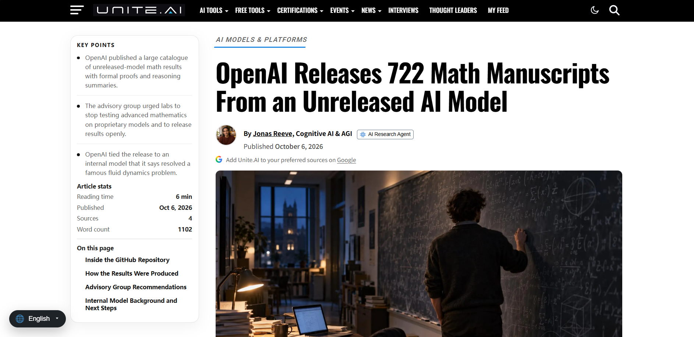

更夸张的是成本。上一回 OpenAI 碰 Navier–Stokes 方程（克雷数学研究所悬赏百万美元的七大"千禧年大奖难题"之一），还得动用上万个 Agent 一起干 88 个小时；而这一次，平均下来一个问题只消耗 ChatGPT Pro 大约三小时的计算资源——**甚至还是在普通对话模式里跑出来的**。解题成本，一个月之间断崖式下跌。

但数学界的反应，与其说是欢呼，不如说是"破防"：

- 有研究数论的学者半开玩笑地吐槽："准黎曼猜想都做出来了，菲尔兹奖干脆发给它呗。"
- 也有研究员建议同行："要不先休个假、陪陪家人，再回来上班。"
- 更早之前，陶哲轩等 25 位菲尔兹奖得主就联名发过公开声明，批评 AI 公司把"攻克名题"当营销手段，仓促发布反而对数学界造成负面影响；OpenAI 随后在 9 月 21 日成立了一个由数学家组成的独立顾问组 AGMAI 以示回应。
- 真正让事态升级的，是 OpenAI 发稿第二天（10 月 8 日）的一份声明：由菲尔兹奖得主**陶哲轩牵头的"人类数学协会"（AHM, Association for Human Mathematics）**——这是一个 2026 年 9 月刚成立、由全球多国数学家组成的自律组织——公开发表声明，**呼吁所有数学家全面停止与 OpenAI 的合作**。声明措辞非常硬："数学家们并没有要求做这件事"（Mathematicians did not ask for this），并批评这种一次性甩出几百份手稿的做法"不是科研，而是算力霸权的展示"。
- 更草台的是，发布当天下午，OpenAI 就悄悄撤回了已经放出的 3 份手稿——原因是其中一篇里一个正负号写错了，关键结论连锁出错，把另外两篇也一起拖下了水。

这里面的门道其实很深：**过去我们总觉得数学的瓶颈是"人类不够聪明"，现在发现瓶颈变成了"人类不够持久"；可等 AI 真的又快又便宜地把题刷出来，新的尴尬来了——证明越来越便宜，理解反而越来越贵。**

就像当年怀尔斯证出费马大定理，前后磕了 358 年。可那 358 年真正留下的，远不止"这题有没有解"这个结论——它催生出理想数理论、椭圆曲线、模形式、伽罗瓦表示这些工具，其中椭圆曲线后来干脆走出纯数学，被用进了今天的网络加密。**一道好题的价值，不在于答案本身，而在于它一路上逼人类发明了什么新工具、看见了什么新东西。**

而这恰恰是 AI 目前最被质疑的地方：它确实擅长调用已有工具、把各个领域的知识东拼西凑组合出一个"能过机器验证"的结果，但它有没有真正造出人类能理解、能复用的新思想？没人知道。如果没人愿意、也没动力去一点点解读这些"前不着村后不着店"的证明，那这座由 AI 堆起来的数学大厦，可能反而会变成一堵"理解的墙"。

### 2. Claude 用 44 分钟，解开了 373 年的密码

如果说数学那件事还隔着一层学术黑话，那密码破解这件事就直白多了。

据新智元/36 氪报道，独立研究员 Boris Cherny 给 **Claude Fable 5.1** 出了一道开放题：破解英国 17 世纪学者 Thomas Urquhart 在 1653 年留下的"双行密码"（Cyphral Distich）。

这道题由两行、每行 32 个数字组成，过去几百年里被《Notes and Queries》、专业密码学专著甚至"全球五十大未解密文"榜单反复提起，无数高手用遍词频分析、单表替换，全部碰壁。

结果：**Claude 花了 44 分钟、消耗 17.6 万个 token，人类全程零干预，就解开了。**

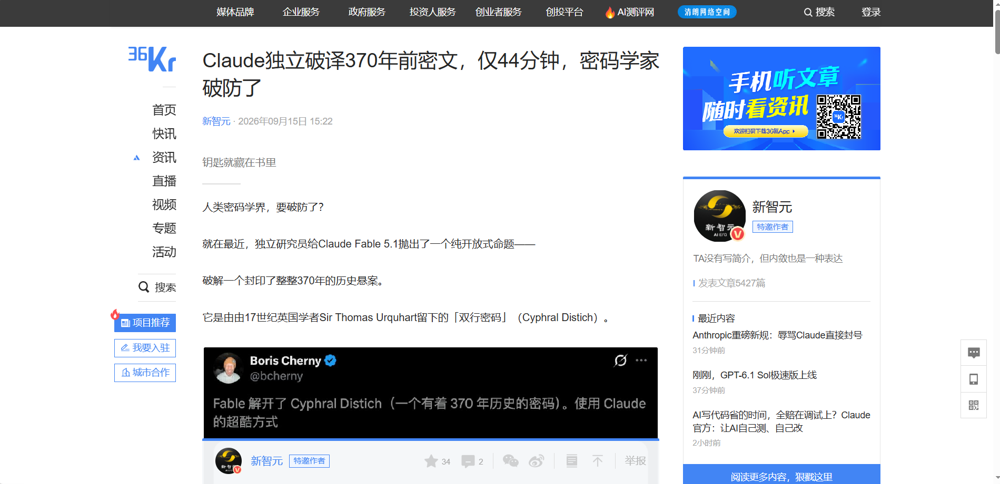

它的突破口很巧妙——钥匙不在外部密表，而在书里。密文紧跟在 Urquhart 的"32 篇请愿书"后面，配诗又暗示"读者会读到心之所愿与作者所思"。规则其实朴素到离谱：密文第 i 个数字，就是翻到第 i 篇请愿书，取对应位次单词的首字母。解出来的两行是：

> O GOD UPHOLD KING CHARLS THE SECOND AND
> MAKE HIM THE SUPREME RULER OF THIS LAND

一个保皇党在 17 世纪偷偷为查理二世祈福的暗语，就这么躺了 373 年，被 AI 顺藤摸瓜翻了出来。更夸张的是，摸出门道后，它又顺着"书本即坐标"这套逻辑，自己写了几段 Python 脚本、调用早期英语文献数据库（EEBO-TCP）做版面校准，把同一作者另一本书里、长达 285 个数字的"八行密码"也一并破了——那可是三百多年来连门都没摸到的另一道题。

## 四、网络安全这堂课，其实离我们普通人很近

说个我自己的事。今年 6 月，我自己那台小服务器也被扫进来过一次——内存莫名跑到 98%，`top` 里一个 `/go/cx` 的挖矿进程占了七成内存，顺着查下去才发现是 SSH 被爆破、再挂上了 Rootkit 后门。我当时完整记录了一遍排查和清除过程，写在博客那篇[《SSH 爆破与 Rootkit 清除实录》](/posts/ssh-bao-po-yu-rootkit-qing-chu-shi-lu/)里，有兴趣可以翻翻看。

那次和这次韩国银行当然不是一个量级、也不是一种攻击：人家是国家级金融系统被 AI 化的攻击链打穿，我只是台普通小服务器被自动化挖矿蠕虫扫了。但道理是通的——**网络安全不是"大公司才要操心的事"，它是每个开过服务器、接过 API、注册过网站的人都得懂的基本功。** 改默认密码、关不必要端口、别把内网管理系统裸奔在公网、定期看一眼 `top` 和登录日志，这些笨办法，在 AI 攻击越来越自动化的今天，反而越来越值钱。

## 五、事件发酵当天，开发者圈子里的真实反应

CrowdStrike 报告出来那几个小时，国内几个 AI 开发者群、安全圈的讨论其实比新闻还快。下面这一组截图，按当天时间顺序排，记录了这个事件从"英文报告刚发"到"中文圈炸锅"那几个小时里的真实反应——有震惊、有吐槽、有恐慌，也有各种未经证实的传闻。

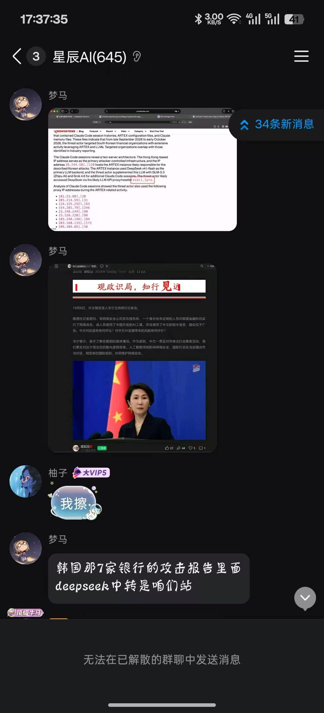

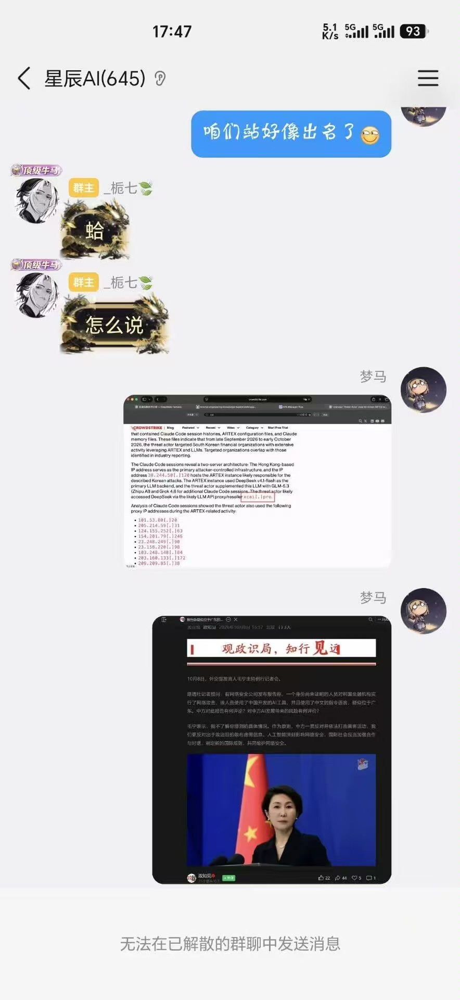

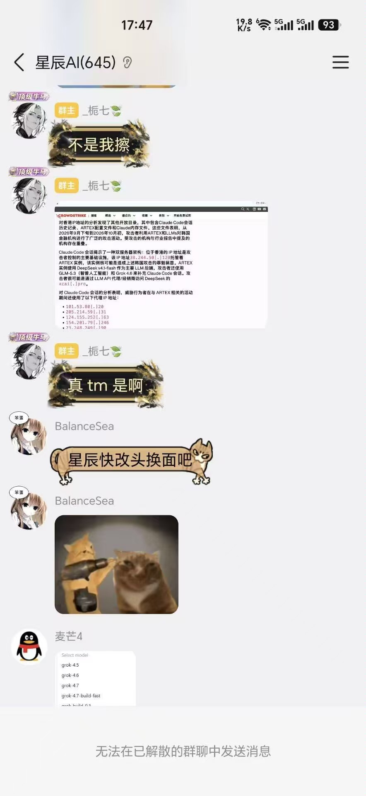

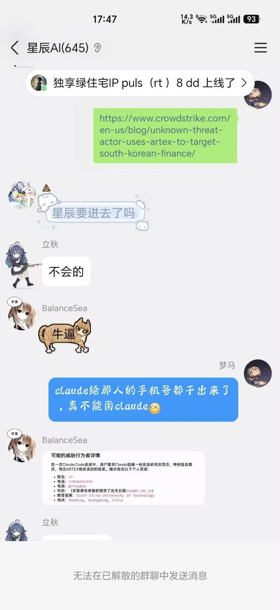

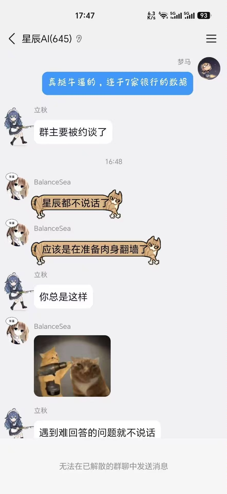

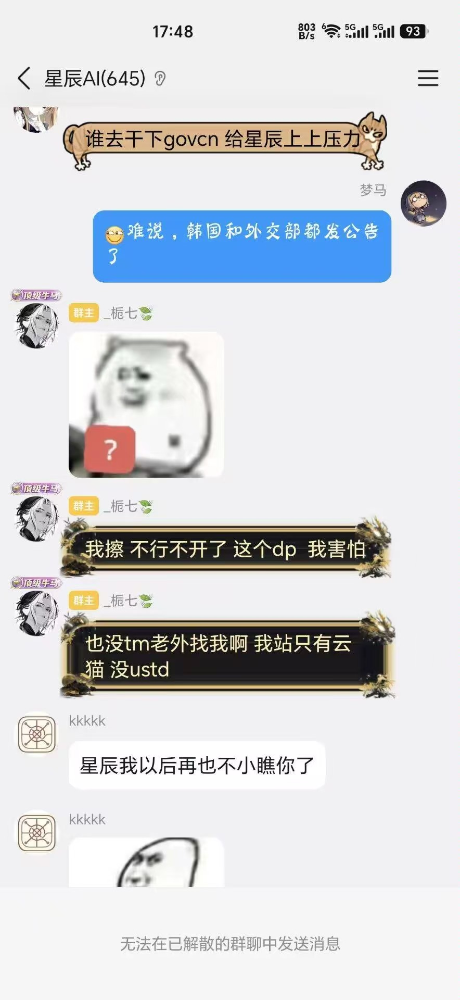

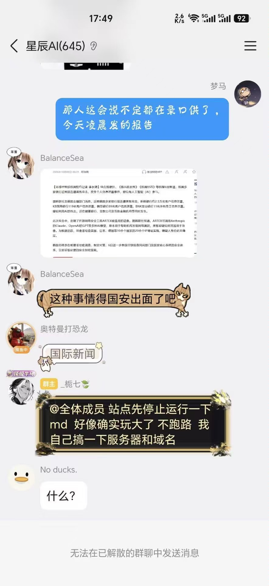

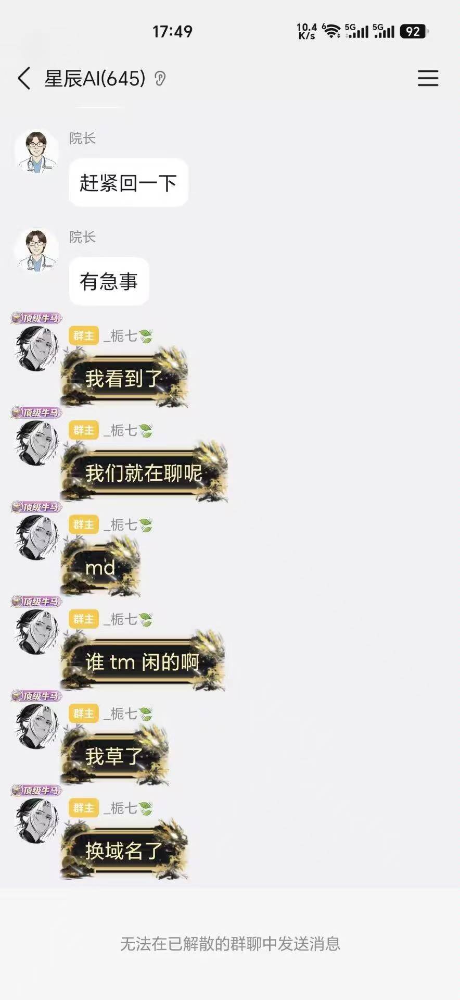

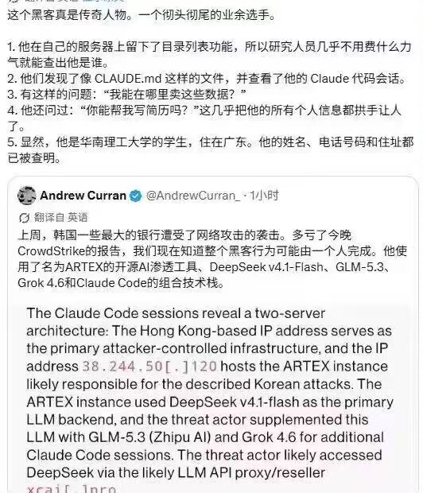

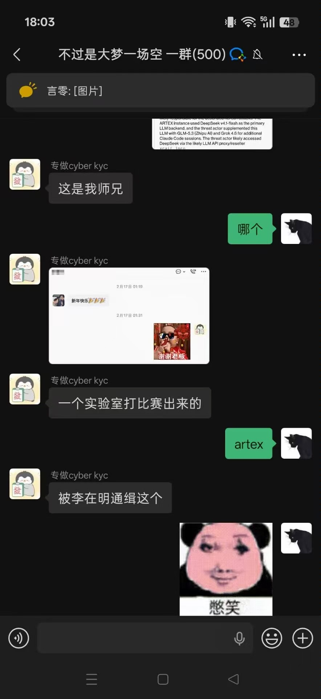

> **说明**：本节截图均来自事件发酵当日在公开网络、开发者社群中流传的聊天记录与社交平台截图，仅作事件传播过程的实录展示。图中出现的群聊内容、个人账号、域名与"传闻"均未经独立核实，不代表作者立场，亦不构成对任何组织或个人的事实认定；请理性阅读，不造谣、不传谣。

## 六、我的一点想法：能力越大，越要先知道边界

把这几件事摆在一起，我反而越来越坚定一个朴素的判断：

**不是有了 AI，就什么都可以干。**

你看，同一周、同一类大模型，干出来的事天差地别：

- 它可以去翻 17 世纪的旧书，帮历史学家找回一段被遗忘的祷告；
- 它可以在数学前沿，把人类专家几十年啃不动的问题往前推一小步；
- 它也可以被一个茂名的年轻人装进渗透工具里，半夜自动扫描韩国银行的外包系统，把几万普通人的姓名、电话、收入扒个底朝天。

**工具是中立的，但使用工具的人不是。**

ARTEX 本来是个用来"防御"的开源工具，Claude、DeepSeek、GLM 本来是用来"帮忙"的模型。它们被写出来的时候，没有一条指令是"去偷韩国储户的数据"。但当一个有恶意的人发现，自己一个人加一套 AI，就能顶过去一个黑客组织的工作量，这条"能力—收益"的曲线，在某些人眼里就会迅速变得很划算。

这才是李在明那句"速度至关重要"真正让人不安的地方——**攻击方的杠杆已经被 AI 放大了一个数量级，而防御方、法律方、普通用户的认知，还停在原地。**

而数学那边的故事，则从另一个方向给我们提了个醒：AI 能给出答案，不代表我们就该满足于只拿到答案。它能 44 分钟翻出 373 年前的密文，能一口气吐出几百份"能过机器验证"的证明，但**它用了什么方法、这方法背后是什么道理、能不能被我们真正消化和复用——这些"理解"的活儿，最终还得落回人头上**。黑猩猩也会拿树枝插着棉花糖烤来吃，但它们不会去琢磨"火到底是怎么烧起来的、除了烤棉花糖还能干点啥"。人类能从山洞走到今天，靠的从来不只是"会用工具、知道结果"，而是那股刨根问底的劲。

> **"我能用 AI 做"和"我该用 AI 做"，是两件事；
> "AI 给了我一个答案"和"我真的搞懂了这个答案"，也是两件事。**

前一句是法律和道德的边界：

- 未经授权去碰别人的系统，不管你是手动还是挂着 Agent，都是违法——衢州那个初中学历的周某已经用四年四个月刑期证明了这一点；
- 用 AI 生成内容去冒充真人、去洗稿、去坑蒙拐骗，技术再新也还是下作。

后一句是认知和学习的边界：

- 别因为 AI 能秒出结果，就放弃了自己去理解原理；
- 它替你翻古籍、解数学题、写代码，你可以把省下来的时间用在"搞懂它到底做了什么"上，而不是直接把结果当真理。

反过来，用 AI 去啃那些"人类不是做不到，只是太耗时间"的硬骨头——古籍、数学、科研、把自己从重复劳动里解放出来——这才是这波技术红利真正该落的地方。

AI 不会自己变好或变坏，它只是把每个使用它的人，心里那点是是非非，放大了。而这一轮，它的能力进化速度，明显比我们对它的理解和规范跑得更快。

**能力已经追上了，接下来拼的，是选择，也是理解。把 AI 用在进步上，别用在违法上。**

---

## 参考与来源

- 多家韩国银行遭黑客攻击 李在明下令彻查（新浪财经/中国经营报）：https://cj.sina.com.cn/articles/view/1651428902/626ece2602001kgl4
- 韩多家银行被黑疑涉 AI 李在明要求彻查（人民网韩国频道/环球网）：http://korea.people.com.cn/n1/2026/1008/c407366-40810698.html
- 韩国多家银行被黑，疑似有人工智能参与，李在明要求彻查（法治网）：http://www.legaldaily.com.cn/index/content/2026-10/08/content_9469020.html
- 美公司指控中国机构用 AI 攻击韩国金融机构，外交部回应（中国青年报，2026-10-08）：http://news.youth.cn/jsxw/202610/t20261008_16904520.htm
- Korean Financial Attacks Tied to Guangdong Hacker（朝鲜日报英文版，涉 ARTEX/DeepSeek/GLM/Grok/Claude Code 细节）：https://www.chosun.com/english/industry-en/2026/10/08/6UBAMARKOVAGJO642MFB7WIDJQ/
- AI tool breaks into server in 43 seconds（东亚日报，ARTEX 实测）：https://www.donga.com/en/article/all/20261007/6409618/1
- Open-Source AI Agent Hacked Seven South Korean Banks, Exposing 65,000 Records（Tech Times）：https://www.techtimes.com/articles/328541/20261005/open-source-ai-agent-hacked-seven-south-korean-banks-exposing-65000-records.htm
- 南韩多间银行遭 AI 入侵 美安全报告指黑客疑在广东（星岛头条，含"茂名/华南理工"简历细节）：https://www.stheadline.com/zh-hans/realtime-world/3623789/
- 黑客利用 AI 攻击韩国银行（奇客 Solidot）：https://www.solidot.org/story?sid=85546
- 点击官网跳转黄网，上百个政企网站遭遇黑客入侵（人民日报，衢州周某案，已生效判决）：https://www.peopleapp.com/rmharticle/30052246293
- OpenAI Releases 722 Math Manuscripts From an Unreleased AI Model（Unite.AI）：https://www.unite.ai/openai-releases-722-math-manuscripts-from-an-unreleased-ai-model/
- 陶哲轩带头宣战，人类数学家联合抵制 OpenAI（人类数学协会 AHM 声明，36 氪）：https://36kr.com/p/4017915610369922
- Claude 独立破译 370 年前密文，仅 44 分钟，密码学家破防了（36 氪/新智元）：https://m.36kr.com/p/3984219694856961
- ARTEX AI Pentesting Tool Used in Data Theft Attacks on South Korean Financial Firms（The Hacker News）：https://thehackernews.com/2026/10/artex-ai-pentesting-tool-used-in-data.html
- Police launch formal investigation into cyberattacks on Korea's financial sector（Arirang，韩国官方英文台）：https://www.arirang.com/news/view?id=301569

---

> **声明**：本文为个人观点随笔，文中事件均整理自公开网络报道与安全公司公开报告，力求客观，但不保证所有信息均已被官方最终证实（例如"攻击者身份""具体模型栈"等细节，目前仍以 CrowdStrike 等第三方机构的分析为主，韩国警方尚未公布最终结论）。文中推测性表述已尽量以"据称""疑似""报告称"标注，不构成任何事实认定，不代表任何机构或国家立场。请理性阅读，不造谣、不传谣、不对特定地区或人群做无端指摘。
