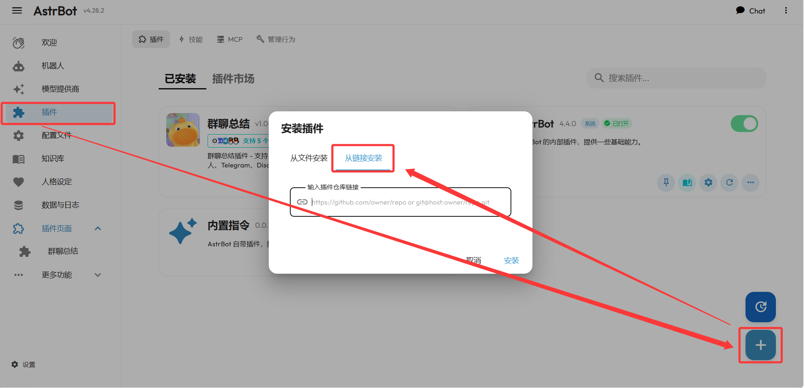
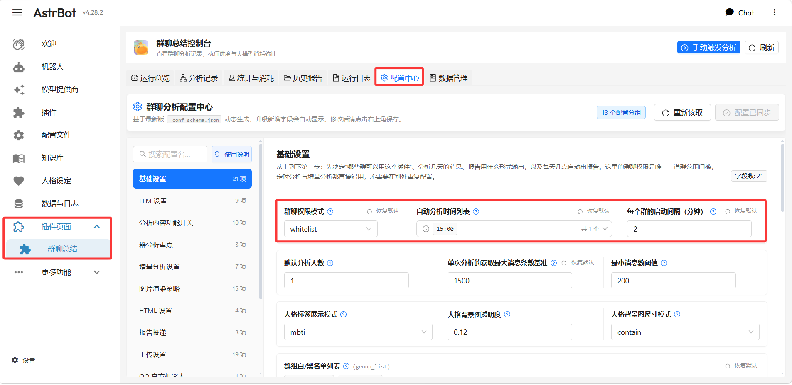
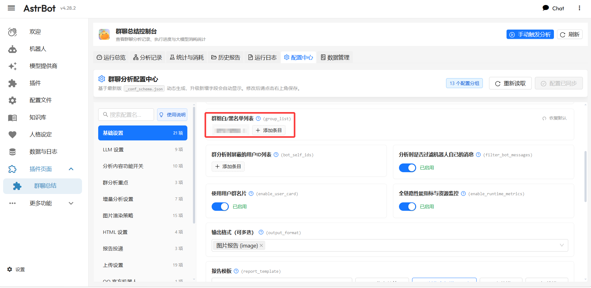
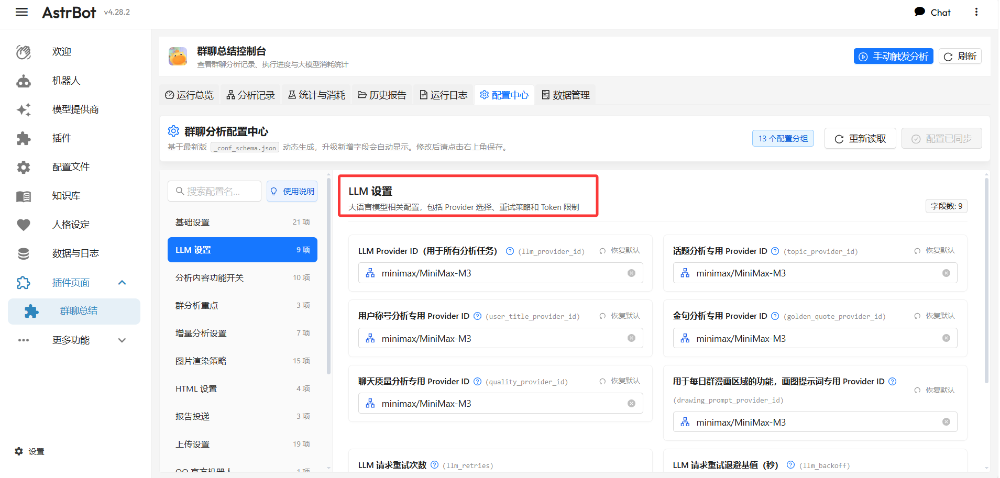
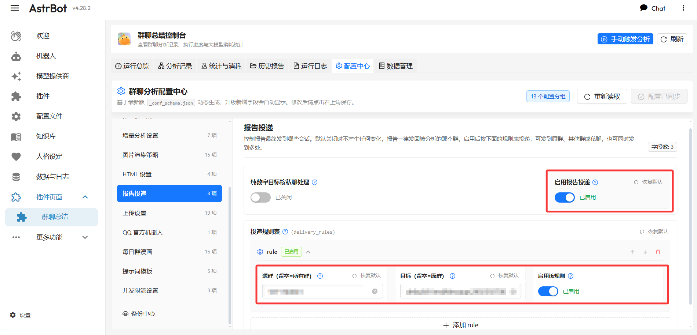
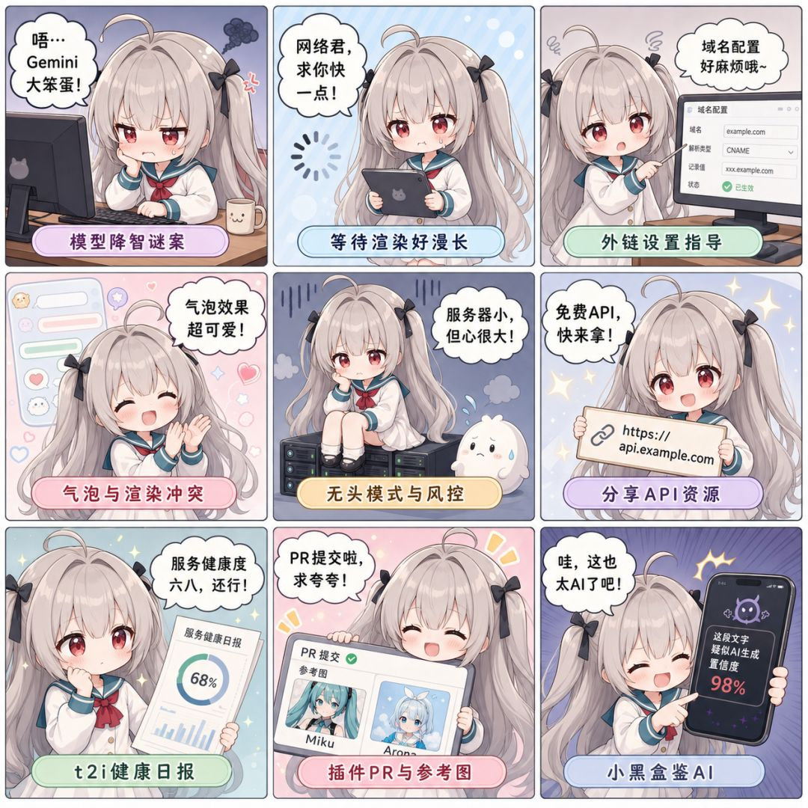

> **一句话结论**：群聊总结插件把「群里今天聊了什么」交给 AI，自动产出一张图文日报、甚至一部四格漫画。这篇不讲部署，只讲装完之后在 WebUI 里怎么配：装插件 → 群权限 → 定时 → LLM 与人格 → 分析内容 → 报告投递 → 每日漫画，全程点鼠标，不写一行代码。

**群聊总结**（`astrbot_plugin_group_digest`）是一个基于 AstrBot 的智能群聊分析插件：它会拉取群里的聊天记录，用大模型提炼出**话题、群友称号、金句、聊天质量分析**，渲染成一张可视化长图报告；开「每日群漫画」的话，还能把分析结果改编成连环漫画。支持 OneBot（NapCat、LLOneBot、SnowLuma）、QQ 官方机器人、Telegram、Discord。

简单来说：**你负责在群里聊，它负责在零点总结你今天聊了啥**，活脱脱一个群聊书记员，还是带毒舌人设的那种。

之前在 [AstrBot 基础使用教程](/blog/astrbot-ji-chu-shi-yong-jiao-cheng) 里讲过部署完之后的通用配置（换模型、设管理员、装插件）。这篇是它的「插件篇」——以群聊总结插件为例，从安装到配置中心全流程过一遍。

如果你想通过服务器自己部署，但还没有服务器的话，你可以看看[腾讯云新用户](https://cloud.tencent.com/act/cps/redirect?redirect=37409&cps_key=3a14fee6c971648adeff4eb009958072)服务器，一年 4-4 配置只需要 100 出头。

## 前置准备

开始配置前，确认这几样已经就位：

1. **AstrBot ≥ 4.24.1**：插件的 WebUI 控制台依赖新版本的自定义页面能力（本文截图环境为 **v4.28.2**）。
2. **一个能用的 LLM 服务**：DeepSeek、OpenAI、MiniMax、Ollama 都行，配置中心里要选 Provider。
3. **管理员权限**：插件所有指令都要求管理员身份，配置完最好在机器人私聊里发 `/分析设置 reload` 立即生效。

> **小提示**：如果你还没装过任何插件，先看下面这一节；装过的直接跳到「认识配置中心」。

## 一、先装插件：把开源地址粘进去就行

插件的开源地址是 `https://github.com/super-mortal/astrbot_plugin_group_digest`。装它不需要翻插件市场，AstrBot 支持直接**从链接安装**：

1. 左侧导航点「插件」，进入插件管理页；
2. 点右下角的**蓝色加号按钮**，弹出「安装插件」窗口；
3. 窗口里选「**从链接安装**」；
4. 在输入框粘贴插件仓库链接：`https://github.com/super-mortal/astrbot_plugin_group_digest`；
5. 点「安装」，等它拉取完成。

装完之后，左侧导航「插件页面」下就会出现「**群聊总结**」，点进去就是插件自带的管理控制台。如果没看到，重载或重启一次 AstrBot。

## 二、装完先认识配置中心

插件的 WebUI 控制台长这样（AstrBot v4.28.2 实机界面）：顶部一排是**运行总览、分析记录、统计与消耗、历史报告、运行日志、配置中心、数据管理**七个板块，全部内嵌在 AstrBot 里，不用额外部署面板。

配置中心有这几个特点，先记住：

- **动态表单**：界面基于插件自带的 `_conf_schema.json` 自动生成，顶部写明「**升级新增字段会自动显示**」，插件升级后不用等新教程；
- **13 个配置分组**：基础设置、LLM 设置、分析内容功能开关、群分析重点、增量分析设置、图片渲染策略、HTML 设置、报告投递、上传设置、QQ 官方机器人、每日群漫画、提示词模板、并发限流设置；
- **搜索 + 使用说明**：分组多记不住？直接搜配置名，或点「使用说明」看字段解释；
- **保存即生效**：改完点右上角保存，显示「配置已同步」。

> **写在前面**：下面的配置流程按「基础设置 → LLM 设置 → 人格 → 分析内容 → 报告投递 → 每日漫画」的顺序走，改完每一项都记得点右上角的**保存**。

## 三、基础设置：先圈定「哪些群能用、几点跑」

这是**最重要的一个分组**，也是新手最容易配错的地方。

### 3.1 群聊权限模式：唯一的群范围门槛

插件判断一个群能不能参与自动分析，只看**一处**——`基础设置 → 群聊权限模式`。定时分析、增量分析都直接沿用这里的设置，不需要在别处重复配置名单。

| 模式 | 效果 |
| --- | --- |
| `whitelist`（白名单） | 只有列表里的群能用。**列表为空时定时任务不会自动跑** |
| `blacklist`（黑名单） | 除了列表里的群，其他群都能用 |
| `none`（不限制） | 所有群都能用 |

一句话版：**基础设置决定「哪些群能用」，定时设置决定「几点跑」，增量设置决定「用哪种方式跑」**。

### 3.2 定时与调度参数

配置中心的「基础设置」分组里，从上到下第一屏就是这些核心参数（截图里是一套已配好的示例）：

| 配置项 | 说明 | 截图示例 |
| --- | --- | --- |
| `群聊权限模式` | 群范围门槛 | `whitelist` |
| `自动分析时间列表` | 每天几点自动跑，24 小时制 `HH:MM` | `15:00` |
| `每个群的启动间隔（分钟）` | 多个群同时到点时的错峰间隔 | `2` |
| `默认分析天数` | 一次分析回溯几天的消息 | `1` |
| `单次分析的获取最大消息条数基准` | 单次拉取的消息上限 | `1500` |
| `最小消息数阈值` | 至少多少条有效消息才触发分析 | `200` |

> **注意**：定时任务按**北京时间（UTC+8）**执行，跟你服务器所在时区无关；时间格式必须 24 小时制（`09:00`、`21:30`），填错会提示。

### 3.3 名单与消息过滤

往下滚是第二屏：名单和过滤相关的开关。

| 配置项 | 说明 |
| --- | --- |
| `群组白/黑名单列表` | 配合权限模式用的群名单，点「添加条目」填入群号或会话 ID |
| `群分析时屏蔽的用户 ID 列表` | 不想让某些人出现在报告里？加进来 |
| `分析时是否过滤机器人自己的消息` | 建议开启，机器人自己的发言不进报告 |
| `使用用户群名片` | 开启后报告里显示群名片而不是原始昵称 |
| `全链路性能指标与资源监控` | 开启后控制台能看到每次分析的耗时、Token 消耗明细 |
| `输出格式（可多选）` | `图片报告 (image)` 默认；`text` 纯文本；`html` 网页 |
| `报告模板` | 长图的视觉模板，手账、ATRI、初音未来、黑客风等 |

> **最容易踩的坑**：白名单填了群但忘了填时间，或者时间格式写错，定时都不会跑；权限模式是 `whitelist` 且名单为空时，**定时任务直接不启动**（等于没有任何群被允许）。

## 四、LLM 设置：接上你的模型

配置好群范围，第二步就是把 LLM 接上。切到「LLM 设置」分组。

**核心思路**：一个**主 Provider** 管所有分析任务（截图里是 `minimax/MiniMax-M3`），另外每个分析模块（话题、称号、金句、聊天质量、漫画提示词）都可以单独指定 Provider——想省钱的话，普通模块用便宜的模型，漫画分镜提示词用贵的。

Provider 没单独指定时，插件按这个顺序回退：

1. 该模块指定的 Provider
2. 主 LLM Provider
3. 当前会话的 Provider
4. 第一个可用的 Provider

其他值得注意的：`LLM 请求重试次数` 和 `重试退避时间（秒）` 对付偶发超时很好用；`流式调用` 开了响应更快，但部分服务商不支持。

## 五、人格：让 AI 有「人味」

同样的数据，不同人格写出来的日报完全是两种画风。插件支持在配置里选人格——内置了**标准毒舌总结官、贴心女仆看板娘、严谨学术研究员、赛博极客观察者**等风格，也可以自定义。

人格生效有个**三级优先级**，记住这个顺序就不容易懵：

1. **强制插件人格（最高）**：配置里开了「强制使用插件指定人格」并选了 ID，那全平台所有群都统一用这一种人设；
2. **继承会话人设（次之）**：开了「继承会话人设风格」后，插件会识别当前群在 AstrBot 里设置的人格（比如 `/persona` 设的），尽量模仿它的说话倾向；
3. **系统默认人设**：上面都关了，或者没识别到，就用默认设定。

> **小提示**：想让「毒舌总结官」这种风格稳定输出，直接开「强制使用插件指定人格」最省心，免得群人格被各种会话设置带跑。

## 六、分析内容开关与群分析重点

`分析内容功能开关` 分组控制日报里出哪些板块：话题分析、用户称号、金句（圣经识别）、聊天质量分析，每个都能单独开关。默认全开，想省 Token 可以只留话题。

`群分析重点` 是进阶玩法：默认所有群用同一套提示词，开启后可以**给不同的群单独指定侧重**：

| 字段 | 说明 |
| --- | --- |
| `启用群分析重点` | 总开关，默认关闭 |
| `全局默认重点` | 写给所有群的共同侧重 |
| `逐群重点规则表` | 一行代表一个群的侧重：重点关注成员、重点提炼链接、关注 @全体、补充说明 |

> **注意**：群分析重点只作为**追加要求**注入，不会替换提示词模板，也不会改变日报的板块结构。

## 七、报告投递与上传

### 7.1 报告发到哪里

默认情况下，报告发回**被分析的那个群**。开启「报告投递」后可以改发到其他群或私聊，甚至一处报告发多处。

判定逻辑只有两句话：

- **有规则命中本次被分析的群** → 报告投递到这些规则列出的**全部目标**；
- **没有规则命中** → 报告发回被分析的那个群（默认行为）。

规则表每行：`源群`（留空=对所有群生效）、`目标`（留空或填「原群」=发回原群，填群号或完整会话 ID=发到指定处）、`启用该规则`。还有个「**纯数字目标按私聊处理**」开关：目标只填了个 QQ 号时，默认当群号，打开后按私聊发。

> **小提示**：完整会话 ID 格式是 `平台ID:消息类型:会话ID`，例如 `aiocqhttp:GroupMessage:123456`。在目标会话里发 `/sid` 就能拿到，直接复制粘贴最稳。

### 7.2 上传归档

`上传设置` 分组（19 项）管报告的文件归档，三块互相独立、可同时开：

| 能力 | 说明 |
| --- | --- |
| 群文件 / 群相册 | QQ 平台专属，报告自动归档到群里 |
| **WebDAV 上传** | 不受平台限制，Telegram、Discord 的报告也能归档到自己的服务器 |

WebDAV 支持**坚果云、Nextcloud、群晖、Alist** 等任意兼容服务：填地址（写到要用的目录为止）、用户名、密码，勾选要归档的内容（图片报告 / HTML 报告 / 每日漫画）即可。

| 服务 | WebDAV 地址示例 |
| --- | --- |
| 坚果云 | `https://dav.jianguoyun.com/dav/群聊总结` |
| Nextcloud | `https://cloud.example.com/remote.php/dav/files/用户名/群聊总结` |
| 群晖 | `https://nas.example.com:5006/群聊总结` |
| Alist | `https://alist.example.com/dav/群聊总结` |

远程子目录支持变量：默认 `${group_id}/${date}`（按群号、日期分目录），留空存根目录。填了「公网访问前缀」，上传成功还会在群里附一条可点击的归档链接。

> **注意**：密码强烈建议用**应用专用密码**而不是账号主密码（坚果云、Nextcloud 都支持生成）。WebDAV 上传失败只写日志、**不影响报告本身发送**，可以在「运行日志」面板按 `WebDAV` 关键字排查。

## 八、每日群漫画：最出圈的功能

每天零点除了日报，还能顺手产出一张连环漫画——把群聊话题改编成四格/六格分镜。这是整个插件最出圈的功能，直接看图：

配置要点（`每日群漫画` 分组，15 项）：

1. `enable_daily_comic` 是**总开关**；`enable_auto_daily_comic` 控制分析完成后是否**自动联动**出漫画（默认开，也可以只用 `/群漫画` 手动出图）。
2. `漫画群名单模式` 默认 `inherit`：直接继承基础群权限，不用重复填名单。
3. 绘图后端 `drawing_backend` 三选一：`builtin`（内置绘图客户端）、`general_plugin`（调「通用生图」插件）、`big_banana`（调「大香蕉」插件）。外部后端失败时默认回退内置。
4. `绘图供应商配置表`：按上游服务选预设，支持 Gemini、OpenAI、MiniMax、豆包 Seedream、通义万相、阶跃星辰等十几家，每个条目独立填 API Key、模型、尺寸、代理，按优先级逐个尝试。
5. `漫画角色方案`：每个方案可单独选漫画专用人格、上传**参考图**（jpg/png/webp），没有参考图就走文生图。开「每天随机切换漫画角色」，每天换一个角色出图。

> **注意**：漫画**不按自然日限流**——每次分析成功都会尝试出图，同一群已有漫画在排队时会自动跳过。自动联动漫画只复用报告里的**话题**，所以想联动出图，得在「分析内容功能开关」里保持**话题分析开启**。

## 九、活跃大群用增量模式

每天几百上千条消息的大群，一次性全量喂给 AI 容易上下文截断。这时候开 `增量分析设置`：

| 模式 | 怎么工作 | 适合 |
| --- | --- | --- |
| **普通模式**（默认） | 到点一次性把全部消息交给 AI 出报告 | 每天几十到两三百条的群，消耗稳定 |
| **增量模式** | 边聊边攒，每累计到设定条数先分析一批，最后合并成一份日报 | 日均几百上千条的活跃大群，避免截断 |

两个关键配置：`启用增量分析`（总开关）、`走增量模式的群`（留空=所有通过群权限的群都走增量，填了=只有列表里的群走增量）。`增量每批消息数` 默认 300，按活跃度调。

> **注意**：增量模式分多次调用 AI，**Token 消耗比普通模式高**。消息量不大的群开它不划算；`增量失败自动回退全量分析` 建议保持开启，增量异常时也能尽量产出报告。

## 十、HTML 报告外链（进阶）

不想发图片、想发一个能点开的网页链接？把 `输出格式` 设为 `html`，再配两处：

1. `html_output_dir`：HTML 文件在服务器上的保存目录（留空用默认）；
2. `html_base_url`：公网访问前缀，比如 `https://report.example.com`。

插件只负责生成 HTML 并拼接链接，**不提供 Web 服务器**——你需要用 Nginx 之类把上面那个目录映射到公网，这一步正好是云服务器的主场。

## 平台适配注意（避坑）

插件对平台适配做得比较细，但有几个**前置要求**得先满足：

| 平台 | 要求 |
| --- | --- |
| QQ（OneBot） | 无需手动配置：插件会自动探测 NapCat、LLOneBot、SnowLuma、go-cqhttp 等协议端并绑定对应方言驱动 |
| QQ 官方机器人 | 需群主允许机器人接收**群内全部消息**；官方群用 `group_openid`，建议 `/sid` 填完整 UMO；只能分析启用后实时缓存的消息 |
| Discord | 必须开启 **Read Message History**（查看消息历史记录）权限，否则分析报 403 |
| Telegram | 机器人不是群管理员时，入群前先在 BotFather 关闭隐私模式（`/setprivacy` → Disable）；已在群内的话要移出再拉回才生效 |

## 速查：常见配置场景

| 想要的效果 | 怎么配 |
| --- | --- |
| 只让一个群自动出报告 | 白名单 + 填该群会话 ID → 填自动分析时间 → 增量保持关闭 |
| 活跃大群用增量模式 | 按上面配好群和时间 → 开 `启用增量分析` → 调每批消息数 |
| 除了某个群其他都自动跑 | 权限模式改 `blacklist`，列表里填「不跑」的那个群 |
| Telegram 填群最稳 | 群内发 `/sid` 复制完整会话 ID 粘贴，别只填纯群号 |
| 改完配置立即生效 | 私聊机器人发 `/分析设置 reload` |

## 常见问题

**Q1：定时任务到点不跑？**
三步自查：① `群聊权限模式` 是不是白名单且列表为空（空了就不会跑）；② 时间格式是不是 24 小时制 `HH:MM`；③ 确认按北京时间（UTC+8）算没错。

**Q2：填群号还是完整会话 ID？**
建议都用 `/sid` 拿到的完整会话 ID（如 `aiocqhttp:GroupMessage:123456`），尤其 Telegram 和 QQ 官方机器人，只填纯群号容易填错平台。

**Q3：每日漫画一直出不来？**
先看总开关和自动联动开关；再确认「分析内容功能开关」里话题分析开着（自动联动依赖话题）；最后查「运行日志」里漫画相关报错，重点看绘图供应商条目是否含有效 API Key。

**Q4：报告渲染报错，日志里出现 `496e7465726e616c...` 这种十六进制？**
这是 `Internal Server` 的 ASCII 十六进制，说明 AstrBot 的 T2I 渲染服务返回了 HTTP 500，多半是 Playwright 无头浏览器渲染超时。查 T2I 服务容器日志（`docker logs -f --tail 100 astrbot-t2i-service`），必要时换渲染端点。

**Q5：WebUI 改完配置没生效？**
保存后插件会自动重载；不放心就在机器人私聊里发 `/分析设置 reload`，立即重排定时任务，不用重启 AstrBot。

> **写在最后**：这套配置跑通之后，机器人每天零点自动产日报、出漫画，群友第二天起来就能围观昨天的「群聊精华」。插件还在快速迭代（增量分析标注 Beta），配置面板是动态生成的，升级后记得回配置中心看看有没有新字段。
